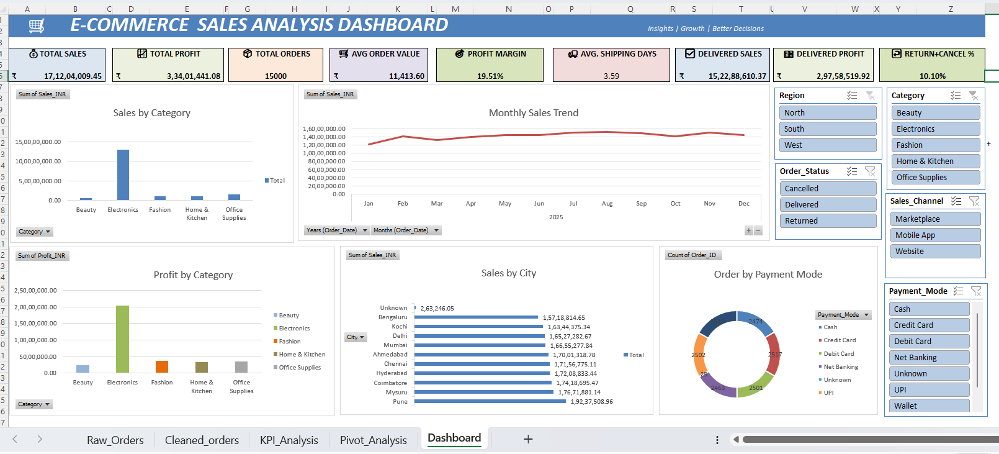

# 📊 E-Commerce Sales Analysis Dashboard Using Excel

## 📌 Project Overview

The **E-Commerce Sales Analysis Dashboard** is a data analytics project developed using Microsoft Excel. The purpose of this project is to analyze e-commerce sales data, understand business performance, identify sales trends, and present important information through an interactive dashboard.

The project follows a structured data analysis process, starting with raw data and moving through data cleaning, validation, analysis, KPI calculations, and dashboard creation.

The final dashboard provides a visual summary of important sales metrics and helps users understand business performance more easily.

## 🎯 Project Objectives

The main objectives of this project are:

* Clean and prepare raw e-commerce sales data for analysis.
* Identify and remove duplicate order records.
* Check missing values and data inconsistencies.
* Validate the cleaned dataset before performing analysis.
* Analyze sales and profit performance.
* Compare sales across products, categories, and regions.
* Understand monthly sales trends.
* Calculate key performance indicators (KPIs).
* Create a dashboard to present the analysis visually.
* Generate useful business insights from the available data.

## 🛠️ Tools and Technologies

**Microsoft Excel**

The following Excel features were used in the project:

* **Excel Formulas and Functions:** To calculate and analyze important metrics.
* **Remove Duplicates:** To identify and remove duplicate order records.
* **Data Cleaning:** To prepare the data for reliable analysis.
* **Data Validation:** To check data consistency and accuracy.
* **PivotTables:** To summarize and analyze sales data.
* **PivotCharts:** To visualize sales performance and trends.
* **KPI Analysis:** To summarize important business performance metrics.
* **Dashboard Design:** To present the results in a clear visual format.

## 📁 GitHub Project Structure

The repository is organized as follows:

```text
excel-ecommerce-sales-analysis/
│
├── ecommerce_sales_analysis_dashboard.xlsx
│
├── dashboard.png
│
└── README.md
```

### File Descriptions

| File                                      | Description                                                                          |
| ----------------------------------------- | ------------------------------------------------------------------------------------ |
| `ecommerce_sales_analysis_dashboard.xlsx` | Excel workbook containing the raw data, cleaned data, analysis, KPIs, and dashboard. |
| `dashboard.png`                           | Screenshot of the completed Excel dashboard.                                         |
| `README.md`                               | Documentation explaining the project, tools, workflow, and analysis.                 |

## 📑 Workbook Sheet Descriptions

The Excel workbook contains the following sheets:

### 1. Raw_Orders

This sheet contains the original e-commerce sales dataset before data cleaning.

It serves as the starting point for the project. The raw data is reviewed to identify duplicate records, missing values, formatting problems, and other possible data-quality issues.

### 2. Cleaned_orders

This sheet contains the sales data after the data-cleaning process.

The data is checked for duplicate order IDs, missing values, inconsistent formats, and other data-quality issues. The cleaned data is then used for further analysis.

### 3. Pivot_Analysis

This sheet contains PivotTable-based analysis.

PivotTables help summarize and compare sales information across different dimensions, such as products, categories, regions, and months.

This makes it easier to identify patterns and compare business performance.

### 4. KPI_Analysis

This sheet contains key performance indicators calculated from the sales data.

KPIs provide a summarized view of business performance and help users understand important metrics without reviewing every individual order.

### 5. Dashboard

This sheet presents the main findings through visualizations and key metrics.

The dashboard brings important information together in one place, making the results easier to understand and communicate.

## 🧹 Data Cleaning and Preparation

Data cleaning is an important step because inaccurate or inconsistent data can affect the reliability of the analysis.

The following activities were included in the project:

1. Reviewed the raw sales dataset.
2. Checked for duplicate order records.
3. Removed duplicate records where identified.
4. Checked for missing values.
5. Reviewed date and numerical data formats.
6. Checked data consistency.
7. Validated the cleaned data before analysis.

The purpose of these steps was to prepare the dataset for analysis and improve the reliability of the results.

## 📈 Analysis Performed

The project focuses on the following areas:

### 1. Sales Analysis

Analyzes overall sales performance to understand the scale of recorded sales.

### 2. Product-Wise Analysis

Compares sales across products to identify products contributing more to recorded sales.

### 3. Category-Wise Analysis

Examines sales and profit across product categories to understand differences in category performance.

### 4. Region-Wise Analysis

Compares sales across regions to identify geographical differences in recorded sales performance.

### 5. Monthly Sales Analysis

Examines sales over time to identify stronger and weaker months and understand monthly trends.

### 6. Profit Analysis

Reviews recorded profit to help understand financial performance across the dimensions available in the dataset.

### 7. KPI Analysis

Summarizes important business metrics to provide a quick overview of performance.

## 📊 Dashboard Preview

The following image shows the Excel dashboard created for this project.



## 💡 Business Questions Addressed

The analysis is designed to answer questions such as:

* What are the overall recorded sales and profit?
* Which products contribute the most to recorded sales?
* Which product categories perform best?
* Which regions record the highest sales?
* Which months have higher or lower sales?
* How do sales and profit vary across different categories?
* What useful patterns can be identified from the sales data?

These questions help organize the analysis around business needs rather than simply presenting raw numbers.

## 🔍 Business Value

The results of this analysis can help a business:

* Understand its recorded sales performance.
* Identify products and categories contributing more to sales.
* Compare performance across regions.
* Recognize monthly sales patterns.
* Monitor key performance indicators.
* Make better-informed decisions using data.

**Data interpretation note:** Sales and profit findings should be interpreted alongside order status. If the dataset includes returned or cancelled orders in its totals, those totals should not be presented as delivered-only sales or profit.

## 🔄 Project Workflow

The project follows this sequence:

**Raw Data → Data Cleaning → Data Validation → PivotTable Analysis → KPI Calculation → Dashboard Creation → Business Insights**

Each stage contributes to preparing, analyzing, and presenting the data in a useful format.

## 📚 Skills Demonstrated

Through this project, I practiced the following data analytics skills:

* Data cleaning and preparation
* Data validation
* Exploratory Data Analysis (EDA)
* Sales and profit analysis
* PivotTables and PivotCharts
* KPI calculation and reporting
* Dashboard development
* Business-oriented analytical thinking
* Data presentation and visualization

## 🏁 Conclusion

This E-Commerce Sales Analysis Dashboard demonstrates how Microsoft Excel can be used to transform raw sales data into organized information and visual business reports.

The project covers important steps in the data analytics process, including data cleaning, validation, sales analysis, KPI reporting, and dashboard development.

It helped me gain practical experience in analyzing business data, comparing sales performance, identifying trends, and presenting results through a dashboard.

This project is part of my learning journey toward becoming a **Data Analyst**.

